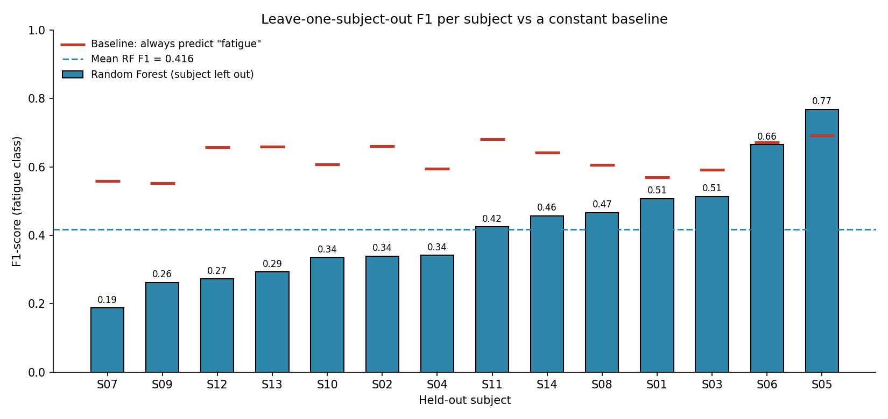
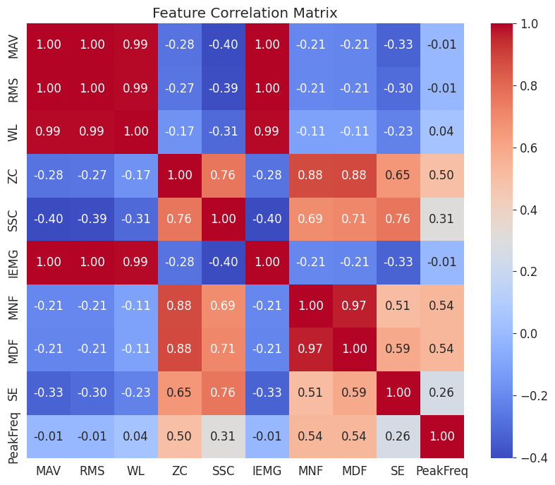
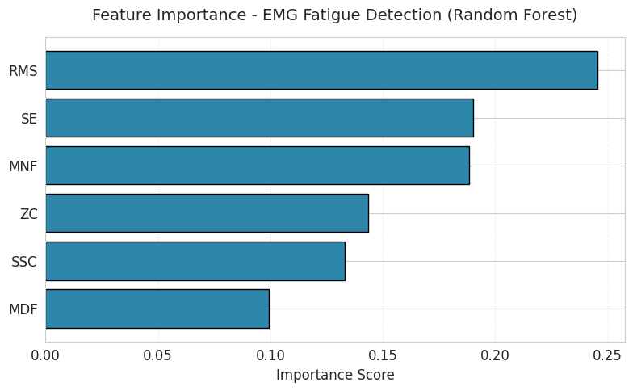

# EMG Muscle Fatigue Classification

Can a model tell a fatigued muscle from a rested one using surface EMG, for a person it has
never seen? This M.Sc. project (SRH University, AI Discovery course) records surface EMG from
14 people, extracts 10 time- and frequency-domain features from 9,540 short signal windows, and
tests classifiers with **leave-one-subject-out** validation.

**Short answer: not yet.** The features differ clearly between fatigue and non-fatigue across
the group, but on an unseen person the best model does not beat a trivial baseline. The
differences between people are larger than the fatigue effect. The notebook reports this rather
than a flattering number.



## Data

- **14 subjects**, **154 recordings** (Backyard Brains recordings, 5 kHz, about 60 s
  each), recorded in a *Fatigue* and a *Non-fatigue* condition.
- Subjects are anonymised as **S01–S14**. The recordings themselves are not included in this
  repository.

## Pipeline

All steps are in [`notebooks/emg_fatigue_classification.ipynb`](notebooks/emg_fatigue_classification.ipynb).

1. **Filter**: 20–450 Hz Butterworth band-pass, rectification, 50 ms moving-RMS envelope.
2. **Find muscle activity**: adaptive burst detection (envelope above its 80th percentile,
   bursts ≥ 0.5 s, gaps < 0.2 s merged) → **1,022 bursts**.
3. **Window**: 250 ms windows with 50% overlap inside each burst → **9,540 windows**
   (4,335 fatigue, 5,205 non-fatigue).
4. **Features** per window: MAV, RMS, waveform length, zero crossings, slope sign changes,
   IEMG, mean and median frequency, spectral entropy, peak frequency.
5. **Evaluate**: leave-one-subject-out (14 folds), with the scaler fitted inside each fold.
   Logistic regression and random forest (300 trees, balanced class weights), on 6
   non-redundant features (RMS, ZC, SSC, MNF, MDF, SE).

## Results

### Group level: the features do differ

| Feature | Median, fatigue vs non-fatigue |
|---|---|
| RMS | −19.2% |
| MAV / IEMG | −18.7% |
| Waveform length | −14.0% |
| Median frequency | +2.0% |
| Mean frequency | +1.1% |

All 10 features differ between the conditions (Mann-Whitney p < 10⁻⁹). Two caveats: windows
from the same recording are not independent, so these p-values are optimistic; and the direction
is the **opposite of the textbook fatigue pattern** (amplitude normally rises and median
frequency falls), which points to the recording protocol or labels rather than physiology.

### Subject level: the classifier does not generalise

Leave-one-subject-out, mean over the 14 held-out subjects:

| Model | Accuracy | Precision | Recall | F1 (fatigue) |
|---|---|---|---|---|
| Logistic regression | 0.465 | 0.384 | 0.640 | 0.460 |
| Random forest | 0.540 | 0.483 | 0.386 | **0.416 ± 0.161** |
| *Always "non-fatigue"* | *0.544* | – | 0 | 0 |
| *Always "fatigue"* | *0.456* | *0.456* | *1.0* | *0.625* |

- The random forest's accuracy is no better than always predicting the majority class, and its
  F1 is below always predicting "fatigue".
- Per-subject F1 ranges from **0.19 to 0.77**; the model beats the constant baseline for
  **1 of 14** subjects (chart above).
- Random-forest importance: RMS (0.25), spectral entropy (0.19), mean frequency (0.19).

| | |
|---|---|
|  |  |

Box plots of all 10 features by class are in [`figures/`](figures/).

## What would help

- **Per-subject normalisation** (e.g. scale each feature by the person's own rested baseline),
  since between-person differences swamp the fatigue effect.
- **A protocol that induces fatigue measurably** (sustained contraction to a % of maximum
  voluntary contraction), then checking that median frequency actually drops before labelling.
- **More subjects**: with 14 people, one unusual subject moves the mean a lot.

## Run it

```bash
pip install -r requirements.txt
```

Put the recordings in `data/<Fatigue|Non Fatigue>/<subject>/*.wav` with their `-events.txt`
files, set `DATA_DIR` in the first cell, and run the notebook top to bottom. It clones
[SpikerTools](https://github.com/BackyardBrains/SpikerTools) to read the files.

Notes on the notebook: the model-comparison cell prints "15 subjects" but there are 14; an
earlier comment mentions "LOSO F1 0.56", which is stale; the final value is 0.416.
